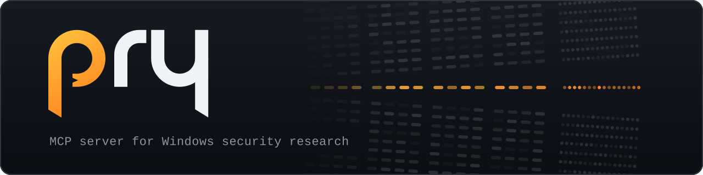

<p align="center">
  
</p>

<p align="center">
  
  
  <a href="LICENSE"></a>
</p>

**pry** is a [Model Context Protocol](https://modelcontextprotocol.io) server that gives AI assistants hands-on tooling for Windows security research. A kernel driver and a user-mode agent on an isolated lab VM sit behind a single local MCP endpoint, so an assistant can inspect, debug and instrument a live Windows target and keep what it learns in a shared findings ledger.

> [!WARNING]
> pry is for authorized security research, testing and education only. Use it only on systems you own or have explicit permission to assess. You are responsible for how you use it.

## Contents

- [Features](#features)
- [Requirements](#requirements)
- [Installation](#installation)
- [Connecting a client](#connecting-a-client)
- [Usage](#usage)
- [Tools](#tools)
- [Configuration](#configuration)
- [Security model](#security-model)
- [Development](#development)
- [Contributing](#contributing)
- [License](#license)

## Features

- **Live memory and process inspection** — read, write, allocate and scan user, kernel and physical memory; enumerate processes, threads, handles, tokens, modules, VADs and heaps on the target.
- **User- and kernel-mode debugging** — DbgEng sessions with software and hardware breakpoints, registers, stepping and stack walks, plus kernel structure, pool and IDT reads.
- **Static and dynamic analysis** — headless IDA and Ghidra sessions, PE and driver analysis without IDA, CPU emulation, and a reconstruct-and-verify loop that compiles a C reconstruction of a function and checks it against the original.
- **Crash-safe lab workflow** — a wedge-to-bugcheck watchdog, post-crash forensics with minidump triage, periodic pre-crash memory snapshots, and helpers for lab boxes that reboot or change address.
- **Shared findings** — a findings ledger and knowledge base shared across assistants, with report generation.
- **Guard rails** — allowlisted targets, a bearer-token agent link, per-machine trust levels and config-gated destructive actions.

How the pieces fit together:

```
MCP client (LLM)
   │  streamable HTTP (127.0.0.1:8765/mcp)
   ▼
Orchestrator (Python 3.12, FastAPI + FastMCP + grpcio)
   │  gRPC (unary + server-streaming), bearer token
   ▼
Agent on the target (pry_agent.exe, C++20, service or console)
   ├── comm/     IOCTL broker → pry_driver.sys (KMDF kernel driver)
   ├── DbgEng    user-mode debugging
   ├── Files     upload, download, hash, dump_module
   └── Exec      processes, one-shot and persistent shells
Driver-free user-mode agent (pry_umagent.exe) — second view for parity checks
IDA / Ghidra bridges — headless sessions proxied through ida_manage / ghidra_manage
Findings — SQLite ledger and report generator; dashboard — web UI with a live feed
```

## Requirements

- **Target:** a Windows 10 or 11 x64 lab VM — snapshot it first. The driver needs administrator rights and `bcdedit /set TESTSIGNING ON` plus a reboot. Some features need HVCI/VBS off.
- **Build host:** Windows 10/11 x64 with Visual Studio 2022 or newer (C++ tools), CMake 3.28 or newer, the Windows Driver Kit (KMDF 1.33+) for the driver, and [vcpkg](https://vcpkg.io) for gRPC (`grpc:x64-windows-static-release`). If `VCPKG_ROOT` is on an exFAT volume, point `VCPKG_DOWNLOADS` at an NTFS path — tool extraction fails on exFAT.
- **Orchestrator host** (may be the build host): [uv](https://docs.astral.sh/uv/) — it provisions Python 3.12 and the orchestrator environment.
- **Optional:** IDA Pro 8.3+ with an activated idalib for `ida_manage`; a Ghidra install, a JDK and pyghidra for `ghidra_manage`.
- An MCP client (Claude Desktop, Claude Code, or any other MCP-compatible client).

## Installation

Build from source — there are no packaged releases.

```powershell
# 1. Build everything: protobuf stubs, driver, agent, umagent, tools and the orchestrator environment
.\scripts\build.ps1                       # -Target user builds user-mode only (no WDK needed)

# 2. Deploy to the lab VM: enables test-signing, copies the binaries, installs the agent service
.\scripts\sign_driver.ps1                 # after any driver change
.\scripts\deploy_to_vm.ps1 -Computer <lab-vm-ip> -Dest C:\pry

# 3. Run the driver gate on the target before enabling driver operations
.\scripts\verify_roundtrip.ps1 -Computer <lab-vm-ip>

# 4. Configure and start the orchestrator
Copy-Item configs\example.yaml configs\local.yaml    # set the target host, token and the authorized_targets allowlist
cd orchestrator
uv sync --extra dev --extra codegen
uv run pry-server --config ..\configs\local.yaml
```

`configs\local.yaml` is git-ignored because it holds the agent token. `scripts\install_orchestrator_service.ps1` installs the MCP host as a Windows service with automatic restart.

**Updating a target.** After the first deployment, `scripts\update_target.py` pushes new builds through the agent's own gRPC channel — no WinRM needed — and reads the host, ports and token from `configs\local.yaml`:

```powershell
.\scripts\build.ps1
orchestrator\.venv\Scripts\python.exe scripts\update_target.py --component all    # or: agent | umagent | driver
```

Agents are replaced by a detached on-target script that stops the service, moves the old binary to `prev\`, promotes the new one, restarts, health-checks the listen port and rolls back on failure. The driver is unloaded, swapped and reloaded; if the unload fails, the new `.sys` is staged as `pry_driver.sys.new` and a reboot completes the swap. Agent and driver must always be deployed together.

## Connecting a client

pry speaks MCP over streamable HTTP. The orchestrator listens on `http://127.0.0.1:8765/mcp` by default and needs no auth unless `mcp.auth_token` is set. Point your client at that URL.

**Claude Desktop** — add this to `%APPDATA%\Claude\claude_desktop_config.json`, then restart the app:

```json
{
  "mcpServers": {
    "pry": { "type": "http", "url": "http://127.0.0.1:8765/mcp" }
  }
}
```

`scripts\install_claude_desktop.ps1` merges the entry for you (backing up the previous file); `-StdioFallback` is for older builds without streamable-HTTP support and `-Remove` undoes it.

**Claude Code**

```powershell
claude mcp add --transport http pry http://127.0.0.1:8765/mcp
```

The repository also ships a project-scope registration in [`.mcp.json`](.mcp.json): open it in Claude Code and approve the project server.

**Other clients** — [`configs/mcp_clients/`](configs/mcp_clients/) has ready-to-paste snippets for Kilo, Cursor, Devin, Antigravity, pi.dev and opencode, and project-scope registrations for most of them are already committed.

To check the connection, ask the assistant to list pry's tools, or call `target_manage(action='tool_index')`.

## Usage

Connect a target (`target_manage(action='connect', machine='lab2')`), then ask in plain language. For example:

- "Connect to `lab2`, list the loaded kernel modules and flag anything that isn't signed by Microsoft."
- "Attach to `notepad.exe`, set a hardware write-breakpoint on this address and tell me which code touches it."
- "Pull `disk.sys` from the target, open it in IDA and map its IRP dispatch handlers."
- "The VM just bugchecked — wait for it to come back, pull the minidump and tell me what crashed."

Every tool describes itself: `<tool>(action='actions')` lists its verbs and shows a worked example, and `target_manage(action='tool_index')` dumps the whole surface.

With `dashboard.enabled: true` the orchestrator also serves a live web UI on `http://127.0.0.1:8766` — session and agent status, the findings ledger, the tool-call log and the machine registry (connect, disconnect, use), updated over a websocket.

## Tools

Consolidated manage-style tools: one tool per domain and an `action` parameter per operation, deliberately without tool sprawl.

<!-- tool-table:start -->
| Tool | Coverage |
|---|---|
| `bin_manage` | Static binary analysis without IDA — artifact `path`/`sha256` or a live module image (`source="memory"`). Parse: info, sections, imports, exports, hashes, imphash, sec, caps. Byte surface: strings, iocs, entropy, scan. Engine: funcs, disasm_func, cfg, xrefs, paths, callgraph — images over ~512 KiB exec background the inventory build (`analyze`, `analyze_status`, `analyze_list`; re-issue once `done`, it hits the warm cache). Drivers: irp_surface, ioctl_surface. Plus audit, diff, pseudo and the ROP passes gadgets, gadget_check, chain_check. |
| `bp_manage` | add / remove / enable / disable / list for software (int3 via dbgeng) and hardware (DR0–3 via the driver, per-thread or `global`) breakpoints; events drains hw-BP hits (kernel int1 hook, DbgEng debug-port fallback for user-space bps). |
| `cpu_manage` | Per-core MSR / CPUID reader (PR#6): msr_read (`msr` accepts int, hex, or well-known name — VM_CR, IA32_EFER, IA32_FEATURE_CONTROL, IA32_VMX_BASIC, …), cpuid (well-known leaves decoded under `decoded`: leaf 1 ECX bits 2/5/31 for VMX/hypervisor_present, 0x80000001 ECX bit 2 for AMD SVM, 0/0x40000000 vendor, 0x80000002..4 brand), list_known_msrs. Driver pins each core via `KeSetSystemGroupAffinityThread`; `__readmsr`/`__cpuidex` under `__try/__except` so #GP on unimplemented MSRs returns per-row `nt_status != STATUS_SUCCESS` (never a bugcheck). Needs the pry driver loaded. |
| `debug_manage` | DbgEng user-mode debugging: launch, attach, detach, continue, step_into / step_over, regs / set_regs, threads, stacktrace, read, write, regions, events (from_seq replay), cmd (raw dbgeng). |
| `desktop_manage` | Desktop/window inspection: capture / displays / windows / window_props / window_tree / window_by_thread; SendInput click / type / key (actuator-trust gated). |
| `device_manage` | ioctl — send one CTL_CODE to a device (double-gated actuator; a bad code can bugcheck the target). ETW inventory lives on event_manage. |
| `dump_manage` | Kernel/usermode crash-dump triage without leaving MCP: `latest` pulls the newest `C:\Windows\Minidump\*.dmp` off the target and parses it (bugcheck code+name, the 4 params, context, stack qwords — resolved to module!sym+off when the dump is same-boot-fresh); `parse` takes a local `path`, an artifact-store `sha256`, or a `remote_path` pulled first. Pry-watchdog bugchecks self-identify (`fired_by='pry_watchdog'`). |
| `emulate_manage` | CPU-emulation sessions (speakeasy default, unicorn escape hatch; codegen extra): create, load_shellcode / load_pe, run, step, regs / set_regs, mem_read / mem_write / map / unmap, hook_add / hook_remove, snapshot / restore, seed_from_target, list, close. |
| `event_manage` | Kernel notify-event stream (process/thread create+exit, image load, bp_hit): subscribe, poll, unsubscribe, list, stats; private ETW sessions (etw_start / etw_stop / etw_tail / etw_events / etw_stats / etw_trace_sessions) and the box-wide ETW inventory (etw_providers / etw_sessions). |
| `exec_manage` | run_exe (args_list for quoting-safe args), run_cmd, run_powershell (script_b64 for -EncodedCommand), run_script (upload local_path / inline script=, shell auto-detect); background=true detaches any run_* verb; run_detached + detached_status / detached_tail / detached_kill / detached_follow for anything that can hang; persistent shells (start_shell / write_console / read_console / stop_shell / shells); call (synchronous in-context function call, gated by `security.allow_function_call`). Process kill / suspend / resume live on process_manage. |
| `file_manage` | upload / download (recursive=true mirrors a remote dir tree into artifacts/downloads/), read (inline ranged file bytes, decode=, side='orchestrator' for artifacts), dump_module (user + kernel PE dumps), hash, list_dir (remote FS), delete, yara, tail, follow_start / follow_poll / follow_stop / follow_list (streamed `tail -f`); orchestrator-side artifacts: read_artifact, grep_artifact, list_artifacts, ingest (local file → artifacts/). |
| `ghidra_manage` | Headless Ghidra engine (opt-in `ghidra.enabled`): same session surface as ida_manage (open, open_async, open_status, list, close, schemas, jobs) over ONE shared JVM + shared project hosting N programs. Decompile, disasm, P-code, xrefs, callgraph, imports/exports, strings, pattern/qword scans, rename/retype/comment/patch, struct layout (`dump_layout` feeds symbols_manage), `exec_ghidra_script` escape hatch; every other action forwards verbatim as a pyghidra backend tool name. Needs Ghidra install + JDK + pyghidra; see `ghidra:` block in configs/example.yaml. |
| `ida_manage` | Headless idalib-mcp sessions: open, open_async, open_status, list, close, schemas; shim extensions create_function, exec_idapython, idb_save, ida_status, ida_log, get_struct_member; every other action forwards verbatim as an idalib-mcp tool name. |
| `kernel_manage` | Kernel structures: pool_scan (pool tag / content scan), idt, struct_read (named struct, decoded). Not generic kernel memory — use memory_manage(space='kernel') for raw bytes. |
| `knowledge_manage` | Shared cross-agent knowledge base: record, update, list, add_evidence, sessions, about, search (FTS), annotate, link, mark_stale, artifacts, export_json. |
| `machines_manage` | Machine registry CRUD: register / set / unregister / list / prune. Persists machine host/ports/token + purpose/note/trust/tags in `artifacts/targets.json`; usable immediately, no restart. `trust` gates actuator verbs via `security.min_trust_actuator`; YAML-defined machines keep their config-sourced endpoints (metadata-only unless `force=true`). |
| `memory_manage` | Memory R/W + address-space + scan/forensics surface: read / write / alloc / free / protect, vad / heaps / heap_info, pattern & value scans (scan_start + scan_*, next_scan), pointer maps / pointer scans, dissect / dissect_compare / heap_attrib, walk_list, follow_chain, leak_scan, watch, disasm / assemble. Verbs with a canonical home elsewhere answer with a `moved` pointer. |
| `module_manage` | Module inventory: list / get / imports / exports / coherency (in-memory image vs on-disk file). No mitigation data on module rows — see process_manage(action='mitigations'). |
| `net_manage` | Network inspection, .user view only: list / interfaces / stats / kill. `kill` gated by `security.allow_kill_connection`. |
| `object_manage` | Handles + object namespace: handles / handle_dup / handle_close / handle_compare / enum, plus the background name-find job (find / find_status / find_result / find_cancel / find_list). |
| `process_manage` | Process inventory: list / get / mitigations (or `verify_mitigations=True` on list) / hidden / kill / suspend / resume. |
| `reconstruct_manage` | Reconstruct-and-verify one function: compile a C reconstruction into a DLL (host MSVC or clang-cl, x64 or x86; gated by `security.allow_host_compile`), then verify it against the original under Unicorn — explicit + boundary + coverage-guided inputs, every declared output compared, the original's block coverage reported. toolchains, compile, call (one run, no gate), verify. A pass is bounded by its inputs and coverage. |
| `reg_manage` | Remote registry get / set / enum / delete — `wow64_32` 32-bit view, `create_subkey`, `recursive` subtree delete, `impersonate` for another user's HKCU. |
| `script_manage` | Plugins under `plugins/` (local `scripts_user/` overlay shadows them): list, run, history. |
| `selfprot_manage` | Driver self-protection: config / status. `config` installs / refreshes / disables the driver's `ObRegisterCallbacks` handle-rights stripper for a PID list (`enable=0/1/2`); `status` reads the counters + whether the altitude install took. |
| `svc_manage` | SCM services + drivers, read-only: list / get / dependencies (service=) / drivers. Row `kind='service'|'driver'`. |
| `symbols_manage` | PDB-backed symbol/type queries: info, ensure (MSDL download/cache), resolve (name → RVA/VA), lookup (VA → nearest symbol), layout; IDA-dumped layout cache: struct_info, resolve_member, enum_info, layouts. |
| `target_manage` | connect / disconnect / reconnect / use (per-chat focus machine) of named target views (`<machine>.kernel` driver-backed, `.user` driver-free umagent), status, targets, sysinfo, host_info, driver_load / driver_unload, parity (kernel-vs-usermode byte-for-byte check), wait_connectable / wait_agent / wait_boot_change, rediscover, boot_recover, post-crash forensics (recent_ops, recent_ops_agent, crash_state, timeline), reboot / shutdown / poweroff / logoff / reboot_abort (actuators), tool_index. Multi-agent: whoami, list_peers, release_peer, subscribe_peers. |
| `thread_manage` | Thread inventory: list / get / stack (kernel+user frame walk) plus one verb per ThreadInspect column — wait / irp (kernel view) and impersonation / com / rpc / power / fiber (user view); `include_*` kwargs on `list` add the same columns to every row. |
| `token_manage` | Token / privilege / SID viewer + mutators: view / lookup_sid / well_known_sids / logon_sessions / enable_privilege / disable_privilege / remove_privilege / set_integrity_level / set_virtualization / impersonate / stop_impersonate / modify_default_dacl. Mutators gated by `security.allow_token_adjust`. |
| `value_manage` | Pure-compute, target-less value ops: cast, views, pack / unpack, swap, split, join, bits, err_lookup, time, guid, encode / decode, str_convert, hash, eval, constants, ioctl_decode / ioctl_encode. |
| `watchdog_manage` | Wedge→bugcheck watchdog: arm, kick, disarm, list; auto_kick / auto_status / auto_stop keep the target alive only while the orchestrator runs. |
<!-- tool-table:end -->

Cross-cutting behaviour:

- Address parameters accept ints, `'0x…'` hex strings or `'module+offset'` (`'ntoskrnl.exe+0x1234'`).
- Errors are enriched: Win32 and NTSTATUS codes come back with symbolic names, and failures carry a typed `kind` so callers can branch instead of parsing English.
- Large responses spill to disk and return a preview plus a handle; reads past the gRPC message cap switch to the server-streaming path automatically.
- Several assistants can share one orchestrator: calls carry a stable `client_id`, shared state is tagged `owner` / `foreign`, and mutating a peer's leases is refused unless `force=true`.
- Destructive operations (`file_manage delete`, `kill_process`, `driver_unload`, `device_manage ioctl`, `watchdog_manage arm`, `exec_manage call`) are marked non-read-only and highlighted in the dashboard's tool-call log.

## Configuration

Settings live in a YAML file passed with `--config` (start from [`configs/example.yaml`](configs/example.yaml)). Unknown or mistyped keys are logged at startup and listed in `target_manage(action='status')`; they are ignored, so a typo in a security knob keeps its safe default.

| Option | Default | Description |
| --- | --- | --- |
| `target.host`, `target.port`, `target.token` | — | Endpoint and bearer token of the kernel-backed agent (must match the agent's `--token`) |
| `targets.user` | — | Endpoint of the driver-free umagent view, used for parity cross-checks |
| `machines.<name>` | — | Named multi-box registry; also managed at runtime with `machines_manage` |
| `security.authorized_targets` | loopback + lab CIDR | Connections to addresses outside these CIDRs are refused before any packet is sent |
| `security.allow_*` | mostly `false` | Gates for delete, connection kill, live kernel dump, token mutators, kernel soft-faults, host compile, remote function calls and hardware-breakpoint hooks |
| `security.min_trust_actuator` | `untrusted` (no gating) | Machines below this trust level need `force=true` for actuator verbs |
| `mcp.bind`, `mcp.port`, `mcp.path` | `127.0.0.1`, `8765`, `/mcp` | MCP endpoint |
| `mcp.auth_token` | unset | Optional shared secret required on every request except the agent beacon |
| `dashboard.enabled`, `.bind`, `.port` | `true`, `127.0.0.1`, `8766` | Web dashboard |
| `artifacts.dir`, `artifacts.findings_db` | `artifacts`, `artifacts/findings.db` | Artifact store and shared knowledge-base database |
| `ida.*`, `ghidra.*` | IDA on, Ghidra off | Analysis engines (install paths, timeouts, backend interpreters) |
| `watchdog.auto_arm`, `snapshots` | off | Re-arm the wedge watchdog after driver load and reboot; periodic capture of chosen memory ranges |
| `PRY_ARTIFACTS_DIR` | — | Environment override for the artifact store root |
| `PRY_MCP_SPILL_DIR` | `<artifacts>/spill` | Where oversized responses spill |
| `PRY_MCP_MAX_BYTES`, `PRY_MCP_MAX_ITEMS`, `PRY_MCP_PREVIEW_BYTES` | 32 KiB, 256, 512 | Response size budget (`-1` disables spilling), list-length cap and inline preview size |
| `PRY_AUDIT_BASE_DIR` | `~/.pry/audit` | Root of the per-session audit trail |
| `--takeover` | off | `pry-server` flag: free the MCP port before binding |

## Security model

pry runs with the privileges of the process that starts it, and the assistant can call any tool it exposes. Keep that in mind:

- Run it against a VM or a dedicated research machine, never one that holds data you care about. Snapshot the VM first.
- Targets are allowlist-gated by `security.authorized_targets`; a connection outside it is refused before any packet leaves the orchestrator.
- The MCP endpoint and dashboard bind to `127.0.0.1` by default, and the agent link is bearer-token authenticated.
- Review tool calls before approving them — most MCP clients show each call for confirmation.
- pry writes to `artifacts/` (artifact store, findings database, spills), `reports/` and its log file; the driver keeps an operation log on the target.
- The driver uses its own IOCTL range, `METHOD_BUFFERED` control with `OUT_DIRECT` / `IN_DIRECT` bulk transfers, pool tag `PryD`, `ExAllocatePool2`, `__try/__except` around every dereference and explicit IRQL checks. Its device is `\\.\PryDrv`, reachable by administrators and SYSTEM only. The kernel ABI is revision-checked at ping, so agent and driver must match.
- `tools\drv_exerciser.exe` exercises every IOCTL independently, and `scripts\verify_roundtrip.ps1` runs the full matrix on the target; no gRPC verb is wired to an unexercised IOCTL.
- Kernel `.text` int3 breakpoints are PatchGuard-unsafe, so kernel breakpoints default to DR0–3 and context operations; int3-in-kernel is for PG-defanged, test-signed lab VMs only. HVCI/VBS block some physical writes, and the agent reports their state at connect.

Found a vulnerability in pry itself? Please report it privately to the maintainers rather than opening a public issue.

## Development

```powershell
cd orchestrator
uv sync --extra dev --extra codegen
uv run pytest -q
uv run ruff check src tests
uv run mypy src/pry
uv run pry-server --config ..\configs\example.yaml
```

The C++ side builds with `.\scripts\build.ps1` and its unit tests run with `ctest --test-dir build -C Release`. When the tool surface changes, run `uv run python scripts/gen_tool_catalog.py` from `orchestrator/`: it regenerates `tests/tool_catalog.json` and the tool table above, which the drift tests check. More design notes live in [`docs/`](docs/).

Project layout:

```
proto/          pry.proto — the agent control plane (all RPCs, status envelope)
driver/         pry_driver.sys — KMDF kernel driver (C, WDK)
comm/           user-mode C++ driver communication library and the shared ABI headers
agent/          pry_agent.exe — gRPC agent for the target (kernel-backed view)
umagent/        pry_umagent.exe — driver-free user-mode agent
tools/          drv_exerciser.exe — one subcommand per IOCTL (the safety gate)
mapper/         manual-map loader (deprecated)
orchestrator/   Python 3.12: MCP server, agent client, IDA/Ghidra bridges, findings, dashboard
plugins/        built-in analysis plugins (a local scripts_user/ overlay shadows them)
scripts/        build, deploy, install, smoke and verification scripts
configs/        example configuration and per-client MCP snippets
docs/           design notes: SDK, debugger MCP, memory scanner, reconstruct-and-verify, ...
assets/         brand assets: logos, banner, icons
```

## License

MIT — see [LICENSE](LICENSE). Third-party components keep their own licenses (Capstone BSD-3, Keystone/Unicorn GPLv2, Speakeasy Apache-2.0); the optional `codegen` extra installs Keystone and Unicorn separately and they are not vendored here.
